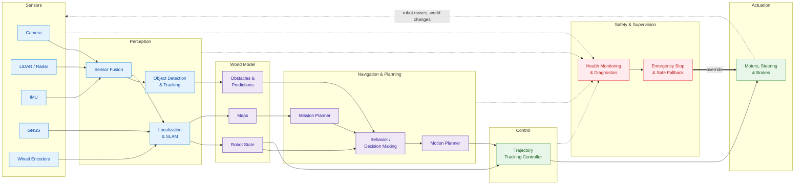

# The Architecture of an Autonomous Robot

Whether it is a self-driving car, a warehouse AMR or a delivery drone, almost every autonomous robot follows the same basic structure: it **senses** the world, **understands** it, **decides** what to do and **acts**, over and over again, while a **safety** layer watches everything.

The colors group the blocks by role: **blue** for sensing and perception, **purple** for understanding and decision making, **green** for acting and **red** for safety.

## The building blocks

### Sensors

The robot's eyes and inner ear. **Exteroceptive** sensors (cameras, LiDAR, radar) observe the environment, while **proprioceptive** sensors (IMU, wheel encoders) measure the robot's own motion. GNSS provides a global position when the sky is visible.

### Perception

Turns raw sensor data into meaningful information:

- **Sensor fusion** combines complementary sensors so that the weaknesses of one are covered by the others (e.g. a camera sees colors and signs, a LiDAR measures distances precisely).
- **Object detection and tracking** finds pedestrians, vehicles and obstacles and follows them over time.
- **Localization and SLAM** answer the question *"where am I?"*, either inside a known map or while building the map at the same time.

### World Model

A shared, up-to-date representation of everything the robot knows: maps, detected obstacles and their predicted motion, and the robot's own state (pose, velocity, battery). Every decision is made on top of this model.

### Navigation and Planning

Decides *what* to do and *how* to do it, usually in three levels:

- **Mission planner**: the long-term goal and the global route (e.g. "go from the dock to aisle 12").
- **Behavior / decision making**: tactical choices such as following a lane, overtaking, yielding or waiting.
- **Motion planner**: a smooth, collision-free trajectory for the next few seconds.

### Control

The controller makes the robot follow the planned trajectory despite disturbances, comparing where the robot *should* be with where it *is* and correcting the error. Common approaches are PID, Pure Pursuit, Stanley and MPC.

### Actuation

Motors, steering and brakes convert the control commands into physical motion. The robot moves, the world changes, and the loop starts again.

### Safety and Supervision

A cross-cutting layer that monitors the health of every module: sensor failures, timeouts, out-of-range values and unexpected behavior. When something goes wrong it triggers a **safe fallback**, such as slowing down, stopping or handing over control, and it can **override** the normal pipeline to command the actuators directly. In real products this layer is often designed according to functional safety standards such as **ISO 26262** (automotive) and **ISO 13482** (service robots).

## Where ROS 2 fits

In a ROS 2 system each block above is typically one or more **nodes**, and the arrows are **topics**, **services** or **actions**. Popular open-source stacks map directly onto this architecture, for example **Nav2** for mobile robots and **Autoware** for self-driving vehicles.
